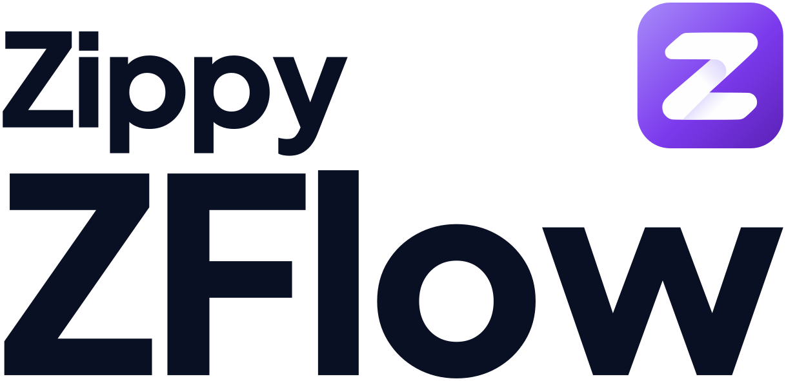
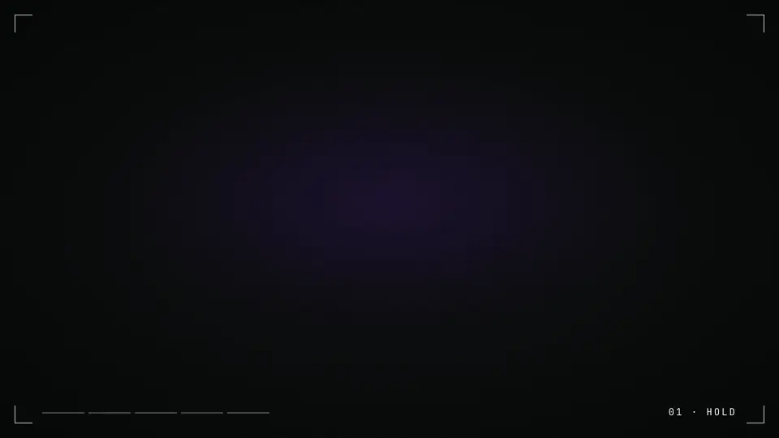

<p align="center">
  <picture>
    <source media="(prefers-color-scheme: dark)" srcset="Brand/readme/hero-dark.svg">
    <source media="(prefers-color-scheme: light)" srcset="Brand/readme/hero-light.svg">
    
  </picture>
</p>

<h3 align="center">Wispr Flow, but free.</h3>

<p align="center">
  Hold a key, speak, and it's typed. Dictation for your Mac: private, instant, unlimited.
</p>

<p align="center">
  <a href="https://github.com/AdamPomposelli/ZFlow/releases/latest"></a>
  
  
  <a href="LICENSE"></a>
  <br>
  <a href="https://TODO-zippy-website"></a>
  <a href="https://TODO-zsquad"></a>
  <a href="https://TODO-x"></a>
  <a href="https://github.com/AdamPomposelli/ZFlow/stargazers"></a>
</p>

<p align="center">
  <a href="https://github.com/AdamPomposelli/ZFlow/releases/latest/download/ZFlow.dmg">
    
  </a>
  <br>
  <sub>No account · No subscription · <a href="#quick-start">Ready in 2 minutes</a></sub>
  <br>
  <sub>Built with ❤︎ by the <a href="https://TODO-zippy-website">Zippy</a> team</sub>
</p>

<p align="center">
  <a href="#quick-start">Quick start</a> |
  <a href="#everything-it-does">Features</a> |
  <a href="#privacy">Privacy</a> |
  <a href="#make-it-yours">Make it yours</a> |
  <a href="#contributing">Contributing</a> |
  <a href="https://TODO-zsquad">ZSquad</a>
</p>

<!-- Made with HyperFrames; source and re-render steps in Brand/demo/. -->
<p align="center">
  
</p>

## 💜 Why ZFlow

Free, private, and good. You shouldn't have to pick.

<table>
  <tr>
    <td align="center" width="72"><h3>💸</h3></td>
    <td><b>Free. Really.</b><br>No subscription, no word cap, no account. On-device mode costs nothing, today and every day after.</td>
  </tr>
  <tr>
    <td align="center"><h3>🔒</h3></td>
    <td><b>Private by design.</b><br>On-device mode keeps your voice on your Mac. No telemetry, no analytics, no ZFlow servers. There is nothing to send it to.</td>
  </tr>
  <tr>
    <td align="center"><h3>✨</h3></td>
    <td><b>Output you'd have typed.</b><br>Raw words the instant you let go, or clean prose with the filler gone, the punctuation right and your own jargon spelled correctly.</td>
  </tr>
</table>

> [!NOTE]
> **Built by people who dictate all day.** We use ZFlow for everything we write. If something gets in the way, we feel it first.

<a id="quick-start"></a>

## ⏱️ Quick start

From download to your first dictation in **under 2 minutes**.

| | Step | ⏱ |
|:-:|---|:-:|
| **1** | ⬇️ **[Download ZFlow.dmg](https://github.com/AdamPomposelli/ZFlow/releases/latest/download/ZFlow.dmg)**, open it, and drag ZFlow onto Applications. | 20 s |
| **2** | 🔓 **Open ZFlow.** macOS blocks the first launch: go to *System Settings → Privacy & Security* and click **Open Anyway**. | 20 s |
| **3** | ✅ **Grant Microphone and Accessibility.** ZFlow opens right on them: one click each. | 20 s |
| **4** | 🏠 **Go local.** In *Voice & AI*, set *Speech to text* and *Cleanup* to **On this Mac**. Free, unlimited, private. | 15 s |
| **5** | 🎙️ **Hold <kbd>fn</kbd>, speak, let go.** Your words appear wherever your cursor is. | <b>0&nbsp;s&nbsp;⚡</b> |

> [!TIP]
> **Not on macOS 26 yet?** On-device mode needs it. Pick a cloud provider in *Voice & AI* instead and paste your key. Groq has a free tier.

> [!IMPORTANT]
> Step 2 is there because ZFlow isn't notarised by Apple yet. You do it once. If macOS asks the same about *ZFlow UI*, the settings window, approve it the same way.

## 🎮 Pick your mode

One click in *Post-Processing* switches between them. Mix and match the settings and it becomes **Custom**.

| | Mode | Wait | What you get |
|:-:|---|:-:|---|
| ⚡ | **Fast** | **0 s** | Exactly what you said, the instant you let go. |
| 🎯 | **Normal** | ~1 s | Cleaned up: punctuation, filler words, your vocabulary, tuned to the app you're in. |
| 💎 | **Quality** | ~3 s | Everything in Normal, plus a look at the window you're typing into for perfect context. |

<a id="everything-it-does"></a>

## ✨ Everything it does

<table>
  <tr>
    <td width="50%" valign="top">⚡ <b>Talk instead of type</b><br>Hold <kbd>fn</kbd> in any app, speak, let go. The words land where your cursor is.</td>
    <td width="50%" valign="top">🧠 <b>It learns your words</b><br>Correct a word right after dictating and ZFlow offers to remember it for next time.</td>
  </tr>
  <tr>
    <td valign="top">✏️ <b>Rewrite with your voice</b><br>Select some text and say what you want: <i>"make it shorter"</i>, <i>"translate to Spanish"</i>.</td>
    <td valign="top">🗒️ <b>Your meetings, written up</b><br>It records the call, tells the speakers apart and writes the summary, on your Mac.</td>
  </tr>
  <tr>
    <td valign="top">🌍 <b>Speaks your language</b><br>10+ languages on-device, 29 with a cloud provider, translated as you go if you like.</td>
    <td valign="top">↩️ <b>Hands off the keyboard</b><br>End with <i>"press enter"</i> and your message is sent.</td>
  </tr>
  <tr>
    <td valign="top">📋 <b>Never lose a word</b><br>Clicked away before the text landed? It's waiting for you, one click from your clipboard.</td>
    <td valign="top">🧷 <b>Your clipboard, untouched</b><br>Whatever you had copied is still there after every dictation.</td>
  </tr>
  <tr>
    <td valign="top">📊 <b>See the time you got back</b><br>Words dictated, your streak, and the hours you didn't spend typing.</td>
    <td valign="top">🕘 <b>Every dictation, kept</b><br>What was heard and what was typed. Retry or delete any of them.</td>
  </tr>
  <tr>
    <td valign="top">📂 <b>Drop in a recording</b><br>Any audio file in, a transcript out.</td>
    <td valign="top">🧩 <b>Bring your own engine</b><br>Apple on-device, Groq, OpenAI, ZenMux, any OpenAI-compatible API, or a model on your own machine.</td>
  </tr>
</table>

## ⌨️ Shortcuts

| Keys | Does |
|---|---|
| Hold <kbd>fn</kbd> | Push-to-talk: speak while held |
| <kbd>fn</kbd> + <kbd>⌘</kbd> | Hands-free: press to start, press again to stop |
| <kbd>esc</kbd> | Cancel the current dictation |

Every shortcut can be changed in *System*.

<a id="privacy"></a>

## 🔒 Privacy

- 🏠 **On this Mac:** audio, transcripts and meeting summaries never leave your Mac.
- ☁️ **With a provider:** audio goes to the provider you chose, with your own key, and nowhere else.
- 🚫 **No account, no telemetry, no analytics.** There is no ZFlow server.
- 📸 **Screen context is off** until you turn it on, and Screen Recording is only requested then.
- 🗂️ **Your data stays put** in `~/Library/Application Support/ZFlow`. Delete any dictation from *History*.

<a id="make-it-yours"></a>

## 🛠️ Make it yours

<details>
<summary>✍️ <b>Write your own cleanup prompt</b></summary>

<br>

In *Post-Processing*, the cleanup prompt is yours to rewrite: tone, formatting, house style. Leave it empty to keep the default, which is shown in the field so you can start from it.

</details>

<details>
<summary>🦙 <b>Run cleanup on a local model (Ollama, LM Studio)</b></summary>

<br>

In *Voice & AI*, set *Cleanup* to a cloud provider and point it at your machine:

| App | Base URL |
|---|---|
| Ollama | `http://localhost:11434/v1` |
| LM Studio | `http://localhost:1234/v1` |

Then enter the model's name. Local models can be slower than a hosted one; give them more time if needed:

```bash
defaults write com.zippy.zflow transcription_timeout_seconds -float 120
defaults write com.zippy.zflow post_processing_timeout_seconds -float 120
defaults write com.zippy.zflow context_request_timeout_seconds -float 120
```

Remove an override with `defaults delete` and the same key.

</details>

<details>
<summary>🧑‍💻 <b>Build from source</b></summary>

<br>

You need the Xcode command-line tools, and Node 22 or later for the settings window.

```bash
make check      # type-check, tests, plist and shell validation
make ui         # build and package the settings window
make run        # build and launch a development build
make release    # the release app and ZFlow.dmg, in build/
```

| | |
|---|---|
| **`Sources/`** · Swift | The app: menu bar, microphone, shortcuts, Accessibility, transcription, cleanup, meetings, history. Built with `swiftc` and Make. |
| **`electron/`** · TypeScript + React | The settings window, and only that. It talks to the app over a loopback bridge: `127.0.0.1` only, a fresh token every launch, credentials writable but never readable. |
| **`Tests/`** | Dependency-free tests, run by `make check`. |
| **`Brand/`** | Logo, palette, type and icon renderer. See [`Brand/BRAND.md`](Brand/BRAND.md). |

`make release` signs ad hoc. Set `RELEASE_IDENTITY` to a Developer ID to sign for distribution; notarising also needs an Apple Developer account.

</details>

<a id="contributing"></a>

## 🤝 Contributing

ZFlow gets better every time someone tells us what got in their way. No contribution is too small.

- 🐛 **Something broke?** [Open an issue](https://github.com/AdamPomposelli/ZFlow/issues/new) and tell us what you expected.
- 💡 **Got an idea?** Pitch it in an [issue](https://github.com/AdamPomposelli/ZFlow/issues) or on the [ZSquad](https://TODO-zsquad).
- 🌱 **First pull request?** Start with a [good first issue](https://github.com/AdamPomposelli/ZFlow/labels/good%20first%20issue).
- 🛠️ **Ready to code?** Fork, branch, run `make check`, and open a pull request. [`AGENTS.md`](AGENTS.md) has the house rules.

## ⭐ Like it? Star it

A star takes one second and helps the next person find ZFlow.

<p align="center">
  <a href="https://star-history.com/#AdamPomposelli/ZFlow&Date">
    <picture>
      <source media="(prefers-color-scheme: dark)" srcset="https://api.star-history.com/svg?repos=AdamPomposelli/ZFlow&type=Date&theme=dark">
      <source media="(prefers-color-scheme: light)" srcset="https://api.star-history.com/svg?repos=AdamPomposelli/ZFlow&type=Date">
      
    </picture>
  </a>
</p>

<!--
  Contributors: uncomment once people outside the Zippy team have contributed.
  A wall of one face says "nobody uses this"; a wall of many says the opposite.

## 💜 Made by

ZFlow exists thanks to everyone who [contributed](#contributing).

<p align="center">
  <a href="https://github.com/AdamPomposelli/ZFlow/graphs/contributors">
    
  </a>
</p>
-->

## 📄 Licence

**MIT.** Take it, change it, ship it, sell it, do whatever you want with it! See [LICENSE](LICENSE).
